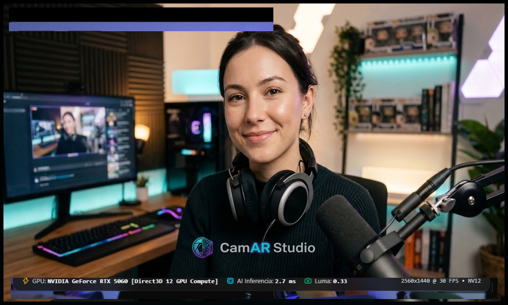

  

  ### Retoque facial, looks de maquillaje y filtros en tiempo real para tu cámara

  <a href="https://juacar01.github.io/CamArStudio/"><b>Página de descarga</b></a> ·
  <a href="https://github.com/juacar01/CamArStudio/releases/latest"><b>Última versión</b></a> ·
  <a href="docs/INSTALL.md"><b>Guía de instalación</b></a> ·
  <a href="CHANGELOG.md"><b>Novedades</b></a>

---

  

## Qué es

CamAR Studio es una cámara virtual para Windows que mejora tu imagen en vivo. Funciona con OBS,
TikTok Live Studio, Zoom, Discord y cualquier programa que use una webcam.

- **Belleza:** piel natural, ajuste de rostro, ojos y labios, y pupilentes.
- **Efectos:** 12 looks de maquillaje, pestañas en 3D y filtros de color.
- **Salidas:** cámara virtual y Spout.

## Prueba y suscripción

Se puede probar gratis, con marca de agua. La suscripción cuesta **COP 35.000 al mes** y quita la
marca de agua en un PC.

## Requisitos

| | Mínimos | Recomendados |
| :-- | :-- | :-- |
| **Sistema** | Windows 10 u 11 de 64 bits | Windows 11 de 64 bits |
| **Procesador** | Intel Core i5 de 7.ª gen o Ryzen 5 | Intel Core i7 o Ryzen 7 |
| **Memoria** | 8 GB | 16 GB |
| **Gráfica** | Compatible con DirectX 11 | NVIDIA RTX 2060 o AMD RX 6600, o superior |

---

© 2026 CamAR Studio. Todos los derechos reservados.
